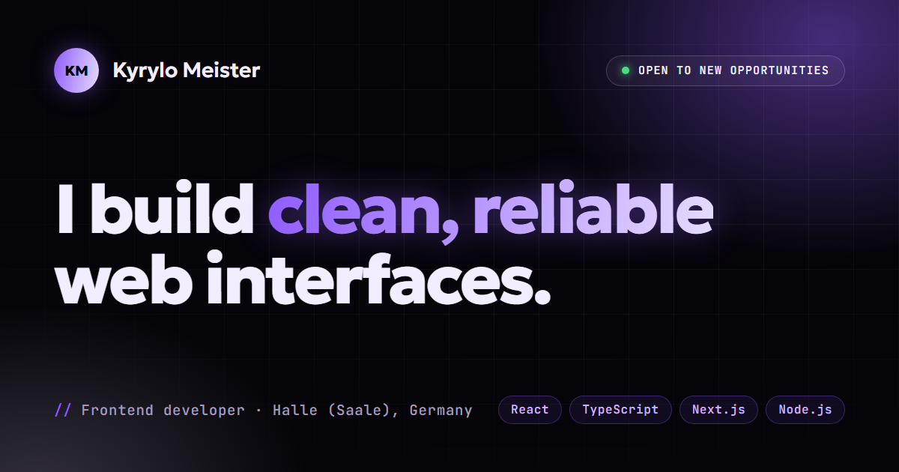

# Kyrylo Meister · Portfolio



My personal portfolio: selected projects, experience and contact. I'm a frontend developer based in Halle (Saale), Germany, working with React, TypeScript and Next.js.

## Features

- **Three languages.** English by default, plus German and Ukrainian. The choice is saved between visits, and `<html lang>` follows it.
- **Live project previews.** Each project page opens the real site in an `iframe` with desktop, tablet and mobile widths.
- **Page transitions** with the View Transitions API: the project card turns into the preview window.
- **Three neon color palettes**, also saved between visits.
- **Respects reduced motion.** Animations and transitions turn off with `prefers-reduced-motion`.
- **Type-safe translations.** All dictionaries share one `Dictionary` type, so a missing string fails the build.

## Projects

| Project | What it is | Stack |
| --- | --- | --- |
| [TaskPro](https://todo-app-tau-inky-54.vercel.app) · [code](https://github.com/PepsaCola/todo-app) | Kanban board with boards, columns, priorities, deadlines and themes | React, Redux Toolkit, Node.js, MongoDB |
| [Kidsstory](https://kidsstory-seven.vercel.app) · [code](https://github.com/PepsaCola/kidsstory) | Multi-page site for an English-language kindergarten | React, React Router, styled-components, Leaflet |
| [BarberShop](https://pepsacola.github.io/BarberShop/) · [code](https://github.com/PepsaCola/BarberShop) | Landing page for a barbershop with a booking pop-up | HTML, Sass, JavaScript |

## Tech stack

React 19 · TypeScript · Vite · React Router · plain CSS (custom properties, `color-mix`, View Transitions)

## Getting started

Requires Node.js 20.19+ or 22.12+.

```bash
npm install
npm run dev
```

| Command | What it does |
| --- | --- |
| `npm run dev` | Dev server at http://localhost:5173 |
| `npm run build` | Type check and production build into `dist/` |
| `npm run preview` | Serves the production build locally |
| `npm run lint` | Runs ESLint |

## Project structure

```
public/            favicon, OG image, photo, CV
src/
  components/      layout, shared UI and home page sections (home/)
  data/            language-independent data: profile, projects, socials
  hooks/           scroll, media query and pointer hooks
  i18n/            dictionaries (en, de, uk), language context, helpers
  pages/           home, project and 404 pages
  styles/          global styles, project page, animations
```

## Adding a project

1. Add an entry to `src/data/projects.ts` and its slug to `ProjectSlug`.
2. Add its texts under `projects` in `src/i18n/en.ts`, `de.ts` and `uk.ts`.
3. Draw a thumbnail in `src/components/ProjectThumb.tsx`.

TypeScript will point out anything that's missing.

## Deployment

Hosted on Vercel. `vercel.json` sends every route to `index.html`, so links like `/projects/taskpro` work on reload. The absolute URL in the Open Graph tags comes from `VERCEL_PROJECT_PRODUCTION_URL` (see `vite.config.ts`).

## Contact

meysterkiril@gmail.com · [LinkedIn](https://www.linkedin.com/in/kyrylo-meister-683678356/) · [Telegram](https://t.me/kyryluch)